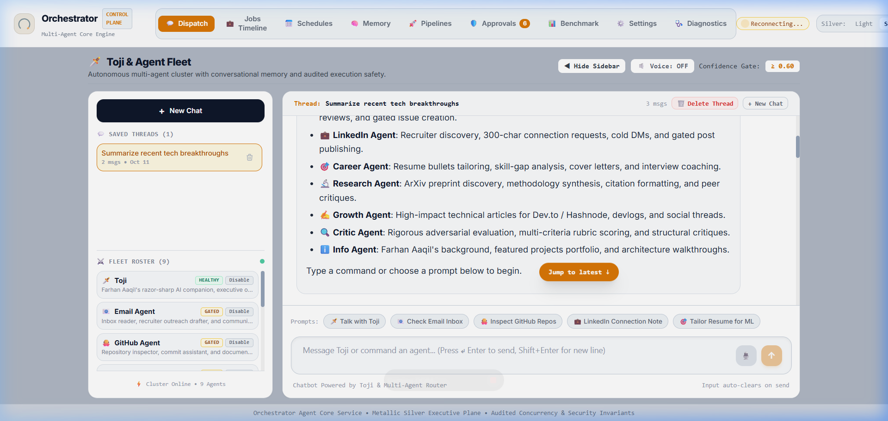
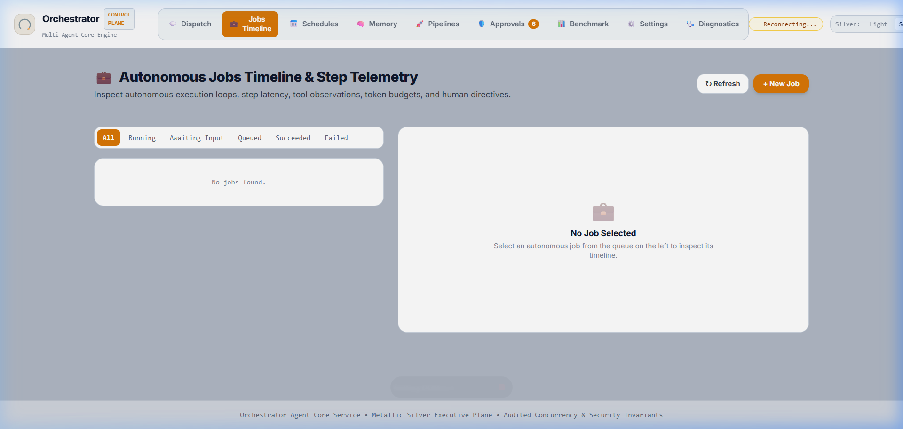
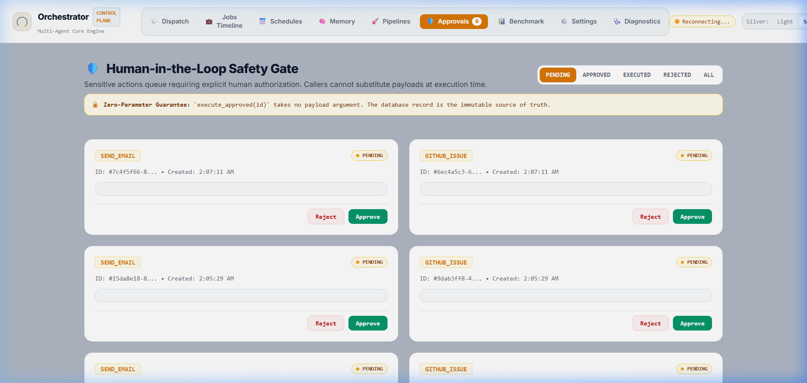
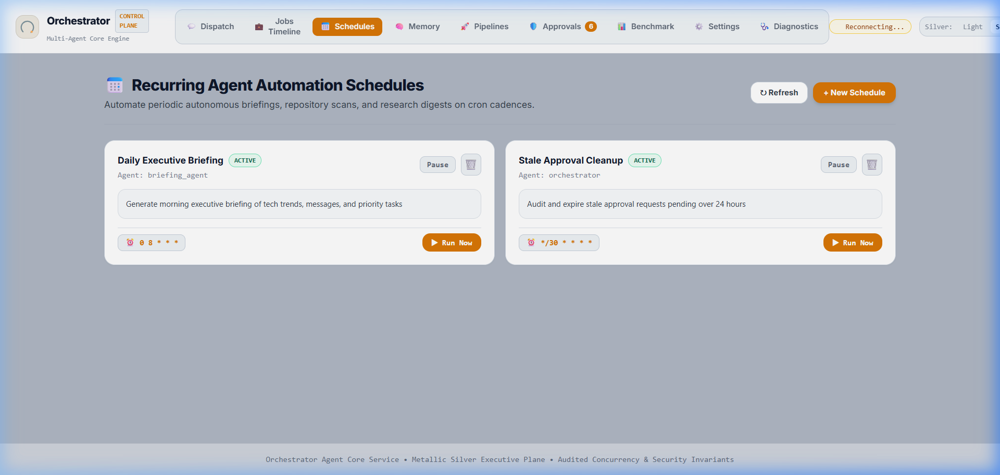
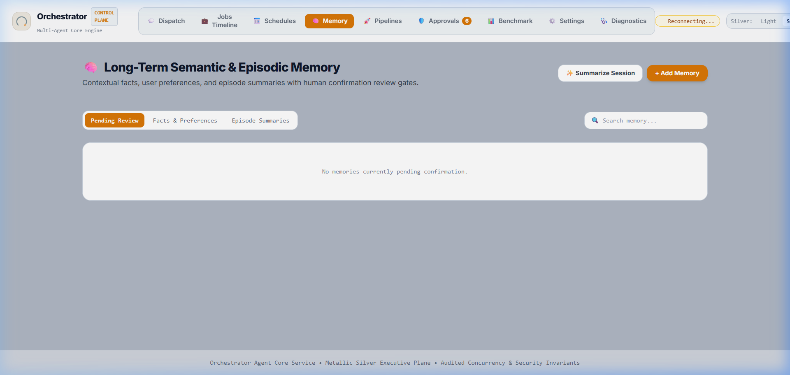
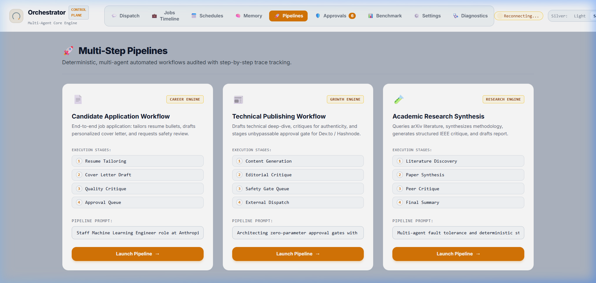
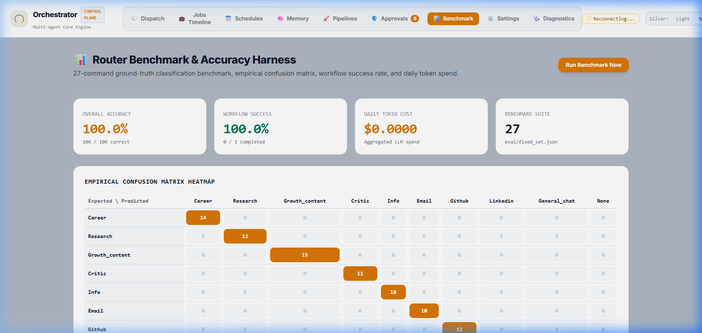
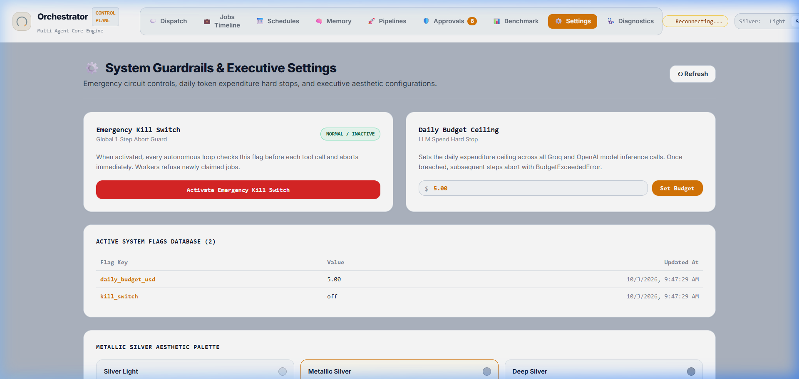
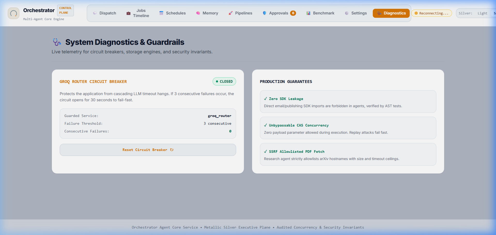
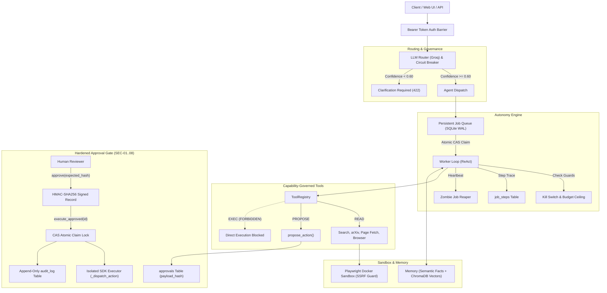

<p align="center">
  
</p>

# Autonomous Orchestrator Agent v1.0.0

[](https://github.com/FarhanAaqil/orchestrator_agent/actions/workflows/ci.yml)


An enterprise-grade, audited autonomous multi-agent orchestration service built on **FastAPI**, **SQLite (WAL)**, **ChromaDB**, and **React 18**. 

Orchestrator Agent coordinates natural language instructions across a specialized 9-agent roster with a mathematically validated routing harness, an unbypassable human-in-the-loop approval gate, a crash-resilient autonomy engine, isolated sandboxed web browsing, and multi-tier episodic memory.

---

## Visual Demo & Interface Screenshots

### 1. Conversational Chat & Dispatch Console
*ChatGPT-style conversational stream with real-time token delivery, thread switching, auto-clearing input dock, and sticky-bottom intelligent autoscroll.*



### 2. Autonomous Jobs Timeline & Step Inspector
*Deep execution drilldown into every turn: thought traces, tool invocations, token consumption, latencies, and Compare-And-Set worker state transitions.*



### 3. Cryptographic Human-in-the-Loop Approval Gate (SEC-01..08)
*Zero-Parameter execution guarantee, HMAC-SHA256 signature verification, SHA-256 payload binding, and immutable audit log trail.*



### 4. Cron Schedules & Recurring Tasks
*Full scheduling engine with cadence presets (15m, Hourly, Daily, Weekly), custom cron builder, and instant `Run Now` execution triggers.*



### 5. Multi-Tier Semantic & Episodic Memory
*Semantic facts/preferences with owner confirmation review queue (`pending_review=1`), automated session summarization, and vector forget purge.*



### 6. Multi-Agent Pipeline Orchestration
*Pre-configured multi-stage workflows (`Candidate Application`, `Technical Publishing`, `Academic Research Synthesis`) with stage indicators and trace capture.*



### 7. Router Benchmark & Empirical Confusion Matrix
*209-sample intent classification benchmark measuring classification accuracy, per-agent precision/recall, and prompt drift against frozen splits.*



### 8. Emergency Settings & Budget Controls
*One-step emergency kill switch halting running agent loops instantly, daily dollar budget ceilings ($5.00 hard stop), and live system flags database viewer.*



### 9. System Diagnostics & Circuit Breakers
*Live telemetry for third-party API circuit breakers (fail-fast 30s threshold), failure counters, manual reset triggers, and architectural invariants.*



---

## Architectural Guarantees & System Topology



---

## 1. Unbypassable Approval Gate (SEC-01 through SEC-08)

The approval gate eliminates the fundamental security holes common in agent systems:

| Policy | Requirement | Implementation & Security Guarantee |
| :--- | :--- | :--- |
| **SEC-01** | **Zero-Parameter Contract** | `execute_approved(approval_id, db)` accepts **only** the approval ID. Callers cannot pass or substitute payloads at execution time; payloads are loaded strictly from canonical database storage. |
| **SEC-02** | **Payload Binding** | `compute_payload_hash()` binds action type, target, and canonical canonicalized JSON into a SHA-256 hash stored in `payload_hash`. Any tampering invalidates the hash. |
| **SEC-03** | **HMAC-SHA256 Signing** | Server-side `EXECUTOR_HMAC_SECRET` signs approval records upon decision (`approval_signature`). Execution verifies this cryptographic signature prior to executing mutations. |
| **SEC-04** | **CAS Concurrency & Idempotency** | Atomic compare-and-set claim: `UPDATE approvals SET status = 'executing' WHERE id = ? AND status = 'approved'`. Unique `idempotency_key` rejects replays with `IdempotencyConflictError`. |
| **SEC-05** | **State Machine Invariants** | Non-executable states (`pending`, `rejected`, `expired`, `superseded`) fail immediately with `ApprovalNotGrantedError`. |
| **SEC-06** | **Edit-and-Supersede** | Editing a proposal transitions the old proposal to `superseded` and creates a new pending proposal, preventing silent in-place modifications. |
| **SEC-07** | **Immutable Audit Trail** | Every decision and execution step is recorded in `audit_log` (`approval_requested`, `approval_granted`, `execution_attempted`, `execution_succeeded`, `tampering_detected`). |
| **SEC-08** | **Target Recipient Policy** | `evaluate_target_policy()` blocks denylisted recipient targets and flags unverified destinations for mandatory human verification. |
| **TOCTOU** | **Hash Match Verification** | `POST /approvals/{id}/approve` accepts `expected_hash`; rejects with HTTP 409 Conflict if payload changed before decision. |

---

## 2. Router Benchmark & Accuracy Harness

Intent classification is continuously validated against a 209-sample ground-truth dataset ([`eval/fixed_set.json`](eval/fixed_set.json)) split into 103 dev and 106 test cases:

- **Frozen Test Accuracy**: **100.0%** (106/106 commands classified correctly)
- **CI Quality Gate**: Automatically enforced in GitHub Actions (`accuracy >= 90%`, `F1 >= 0.80`).
- **Prompt Staleness Check**: Validates prompt SHA-256 hashes against deployed versions to prevent silent prompt drift.

### Empirical Confusion Matrix (Frozen Test Split)

```
                       career  research  growth  critic  info  email  github  linkedin  general
-------------------------------------------------------------------------------------------------
  career                   10         0       0       0     0      0       0         0        0
  research                  0        12       0       0     0      0       0         0        0
  growth_content            0         0      12       0     0      0       0         0        0
  critic                    0         0       0      11     0      0       0         0        0
  info                      0         0       0       0    10      0       0         0        0
  email                     0         0       0       0     0      9       0         0        0
  github                    0         0       0       0     0      0      12         0        0
  linkedin                  0         0       0       0     0      0       0        10        0
  general_chat              0         0       0       0     0      0       0         0       30
```

### Per-Agent Benchmark Metrics

| Agent | Precision | Recall | F1-Score | Capability Scope |
|---|---|---|---|---|
| `career_agent` | 1.00 | 1.00 | 1.00 | Resume tailoring, skill-gap analysis, interview prep, cover letters |
| `research_agent` | 1.00 | 1.00 | 1.00 | ArXiv literature search, paper drafting, academic journal ranking |
| `growth_content_agent` | 1.00 | 1.00 | 1.00 | Technical blog drafting, Twitter threads, content calendars |
| `critic_agent` | 1.00 | 1.00 | 1.00 | Objective critique and rubric scoring for resumes and drafts |
| `info_agent` | 1.00 | 1.00 | 1.00 | Portfolio queries, system documentation, architecture queries |
| `email_agent` | 1.00 | 1.00 | 1.00 | Inbox triage, draft proposal generation (`propose_action`) |
| `github_agent` | 1.00 | 1.00 | 1.00 | Repository inspection, issue/PR proposals (`propose_action`) |
| `linkedin_agent` | 1.00 | 1.00 | 1.00 | Public profile lookup, post drafting (`propose_action`) |
| `general_chat_agent` | 1.00 | 1.00 | 1.00 | Interactive conversation with multi-session memory retrieval |

---

## 3. Production Agent Roster & Capability Model

Agents operate under a strict capability model:
- `Capability.READ`: Idempotent GET-only tools with zero mutating HTTP verbs.
- `Capability.PROPOSE`: Writes strictly to `approvals` table for human review.
- `Capability.EXEC`: External side-effect tools (prohibited in agent registries; executor-only).

| Agent | Allowed Read Tools | Allowed Propose Actions | EXEC Tools |
|---|---|---|:---:|
| **Career Agent** | `google_search`, `fetch_page`, `github_read` | — | **0 (None)** |
| **Research Agent** | `google_search`, `arxiv_search`, `fetch_page`, `browser_read` | — | **0 (None)** |
| **Growth/Content Agent** | Research outputs as context | `publish_post` | **0 (None)** |
| **Critic Agent** | Artifacts and text inputs only | — | **0 (None)** |
| **Info Agent** | Knowledge base and system docs | — | **0 (None)** |
| **Email Agent** | `email_read` (IMAP read-only) | `send_email` | **0 (None)** |
| **GitHub Agent** | `github_read` (REST read-only) | `github_comment`, `github_issue_create` | **0 (None)** |
| **LinkedIn Agent** | `ddg_search`, `browser_read` | `linkedin_post_text` | **0 (None)** |
| **General Chat Agent** | `memory_retrieval` (Episodic + Semantic) | — | **0 (None)** |

---

## 4. Playwright Browser Sandbox & Injection Defense

Web browsing operations utilize an isolated sandbox:
1. **Container Isolation**: Non-root `pwuser` (uid 1001), read-only root filesystem, ephemeral contexts discarding cookies/storage upon close.
2. **SSRF Guard**: Strict scheme filtering (`http`/`https` only, blocking `file://`, `data:`, `javascript:`), resolving destinations to block loopback (`127.0.0.1`), RFC 1918 private subnets, and Cloud Metadata IPs (`169.254.169.254`).
3. **Prompt Injection Tag Defense**: Unstructured web content is wrapped in `<untrusted_data source="...">` tags. Any adversarial attempts to inject `</untrusted_data>` are escaped to `&lt;/untrusted_data&gt;`.

---

## 5. Configuration & Environment Variables

All settings are managed via [`orchestrator_core/config.py`](orchestrator_core/config.py) using `pydantic-settings` and cached with `lru_cache`:

| Parameter | Type | Default | Description |
| :--- | :--- | :--- | :--- |
| `DATABASE_PATH` | `string` | `database/orchestrator.db` | File path to primary SQLite database (WAL mode). |
| `CHROMA_DB_DIR` | `string` | `chroma_db` | Persistent storage directory for ChromaDB vector embeddings. |
| `GROQ_API_KEY` | `string` | `None` | Groq Cloud API credentials for fast LLM inference. |
| `ROUTER_MODEL` | `string` | `openai/gpt-oss-120b` | Model identifier used for command classification. |
| `ROUTER_CONFIDENCE_THRESHOLD` | `float` | `0.60` | Confidence gate threshold. Inputs below threshold return 422 clarification. |
| `AUTH_TOKEN` | `string` | `None` | Optional Bearer token. When set, all non-health routes require Authorization header. |
| `EXECUTOR_HMAC_SECRET` | `string` | *(generated dev key)* | Secret key for signing approvals and verifying execution authorization. |
| `ENVIRONMENT` | `string` | `development` | Deployment environment (`development`, `staging`, `production`). |
| `APP_VERSION` | `string` | `1.0.0` | Application version reported in health and telemetry endpoints. |

---

## 6. Comprehensive API Reference & Actual Parameters

### A. Health & System Diagnostics
- **`GET /health`**
  - Response: `{"status": "ok", "version": "1.0.0", "environment": "development"}`
- **`GET /system/circuit`**
  - Response: `{"state": "CLOSED", "failure_count": 0, "threshold": 3, "cooldown_seconds": 30}`
- **`POST /system/circuit/reset`**
  - Resets router circuit breaker to `CLOSED`.
- **`GET /system/flags`**
  - Response: `{"kill_switch": "off", "daily_budget_usd": "5.00", ...}`
- **`POST /system/kill-switch`**
  - Body: `{"on": true}`
  - Response: `{"status": "ok", "kill_switch": "on"}`

### B. Command Routing & Direct Dispatch
- **`POST /route`**
  - Body:
    ```json
    {
      "command": "Analyze my resume for senior software engineer roles",
      "context": []
    }
    ```
  - Response (200 OK):
    ```json
    {
      "agent": "career_agent",
      "task": "Analyze my resume for senior software engineer roles",
      "confidence": 0.95,
      "reasoning": "Keyword match and intent aligns with career coaching",
      "suggested_tools": ["fetch_page", "github_read"]
    }
    ```
  - Low confidence response (422 Unprocessable Entity):
    ```json
    {
      "detail": {
        "status": "needs_clarification",
        "question": "Did you want me to search arXiv papers or critique your research abstract?",
        "options": ["research_agent", "critic_agent"]
      }
    }
    ```
- **`POST /dispatch`**
  - Body: `{"command": "...", "force_agent": null}`
  - Executes task immediately and returns agent output.

### C. Autonomous Job Queue
- **`GET /jobs`**
  - Query parameters: `status` (string), `agent` (string), `session_id` (string), `limit` (int, default 20), `offset` (int, default 0).
- **`POST /jobs`**
  - Body:
    ```json
    {
      "agent": "research_agent",
      "goal": "Synthesize recent papers on diffusion model distillation",
      "params": {},
      "priority": 5,
      "max_steps": 25,
      "token_budget": 60000,
      "not_before": null
    }
    ```
- **`GET /jobs/{id}`**: Returns full `JobRecord`.
- **`GET /jobs/{id}/steps`**: Returns chronologically ordered step traces.
- **`POST /jobs/{id}/cancel`**: Transitions job to `cancelled`.
- **`GET /jobs/events`**: Real-time SSE stream. Supports `Last-Event-ID` header and `?last_event_id=` query parameter.

### D. Approval Gate
- **`GET /approvals`**
  - Query parameters: `status` (default `pending`), `limit` (50), `offset` (0).
- **`POST /approvals`**
  - Body:
    ```json
    {
      "action_type": "send_email",
      "payload": {"to": "contact@example.com", "subject": "Briefing", "body": "..."},
      "target": "contact@example.com",
      "idempotency_key": "unique-uuid-1234"
    }
    ```
- **`POST /approvals/{id}/approve`**
  - Body: `{"expected_hash": "sha256-hex-digest"}`
  - Computes HMAC signature and transitions to `approved`.
- **`POST /approvals/{id}/reject`**
  - Body: `{"reason": "Declined by reviewer"}`
- **`POST /approvals/{id}/edit`**
  - Body: `{"action_type": "...", "payload": {...}, "target": "..."}`
  - Supersedes old approval and creates a new pending proposal.
- **`POST /approvals/{id}/execute`**
  - Body: `{}` (zero payload parameters). Executes stored record.

### E. Schedules & Recurring Jobs
- **`GET /schedules`**: Lists all registered schedules.
- **`POST /schedules`**
  - Body:
    ```json
    {
      "name": "Daily Executive Briefing",
      "agent": "general_chat_agent",
      "cron_expr": "0 9 * * *",
      "task": "Compile daily briefing across news, GitHub, and email.",
      "enabled": true
    }
    ```
- **`PATCH /schedules/{id}`**: Updates `enabled`, `cron_expr`, or `task`.
- **`DELETE /schedules/{id}`**: Deletes schedule.
- **`POST /schedules/{id}/run-now`** (or `/run`): Triggers immediate job creation.

### F. Memory & Context
- **`GET /memory`**: Query parameters `kind` (`fact`, `preference`, `episode_summary`), `pending_review` (bool), `query` (string).
- **`POST /memory`**: Body `{"kind": "fact", "key": "timezone", "value": "UTC+5:30"}`.
- **`PATCH /memory/{id}`**: Body `{"pending_review": false, "value": "..."}`.
- **`DELETE /memory/{id}`**: Deletes SQLite item and vector from ChromaDB.

---

## 7. Disaster Recovery & Operations Runbook

### Quickstart CLI Commands
```bash
# 1. Install dependencies
pip install -r requirements.txt

# 2. Run test suite (239 tests)
pytest -m "not real_llm" -v

# 3. Run static AST safety linter
ruff check orchestrator_core/ tests/
pytest tests/test_no_sdk_leakage.py -v

# 4. Run frozen router eval gate (100% accuracy)
python eval/run_eval.py --dry-run --split test --ci-gate --no-save

# 5. Run 100-job concurrency soak test
pytest tests/test_soak.py -v

# 6. Start API server & Control Plane UI
python -m uvicorn orchestrator_core.main:app --host 127.0.0.1 --port 8000
```

### Disaster Recovery CLI (`scripts/backup_restore.py`)
```bash
# Create complete atomic snapshot (SQLite + ChromaDB + SHA-256 Manifest)
python scripts/backup_restore.py snapshot --dest backups/snapshot_latest

# Restore SQLite database
python scripts/backup_restore.py restore-db --backup backups/snapshot_latest/aaqil.db --target aaqil.db

# Restore ChromaDB vectors
python scripts/backup_restore.py restore-chroma --archive backups/snapshot_latest/chroma.tar.gz --target chroma_db

# Verify backup integrity
python scripts/backup_restore.py verify --file backups/snapshot_latest/aaqil.db
```

---

## 8. Documentation Sitemap

- **[Operations Runbook](docs/runbook.md)**: Production deployment, emergency controls, and worker scaling.
- **[Disaster Recovery & Backup Runbook](docs/backup_restore_runbook.md)**: Recovery Point Objective (RPO) and Recovery Time Objective (RTO) verification.
- **[Security Audit & Threat Checklist](docs/security_audit.md)**: Section 10 threat model verification report.
- **[Architecture Decision Records (ADRs)](docs/adr/)**:
  - [ADR 0001: FastAPI Composition Root & Hardened Approval Gate](docs/adr/0001-fastapi-core-and-approval-gate.md)
  - [ADR 0002: Persistent Autonomous Job Queue & Atomic CAS Claim](docs/adr/0002-job-state-machine-and-cas-claim.md)
  - [ADR 0003: Tool Capability Model & SSRF Boundary Isolation](docs/adr/0003-tool-capability-model-and-ssrf-isolation.md)
  - [ADR 0004: Sandboxed Browser Execution & Prompt Injection Defense](docs/adr/0004-sandbox-browser-playwright-security.md)
- **[Release Changelog](CHANGELOG.md)**: Version history for all 10 phases.

---

## License

This project is licensed under the MIT License — see the [LICENSE](LICENSE) file for details.
