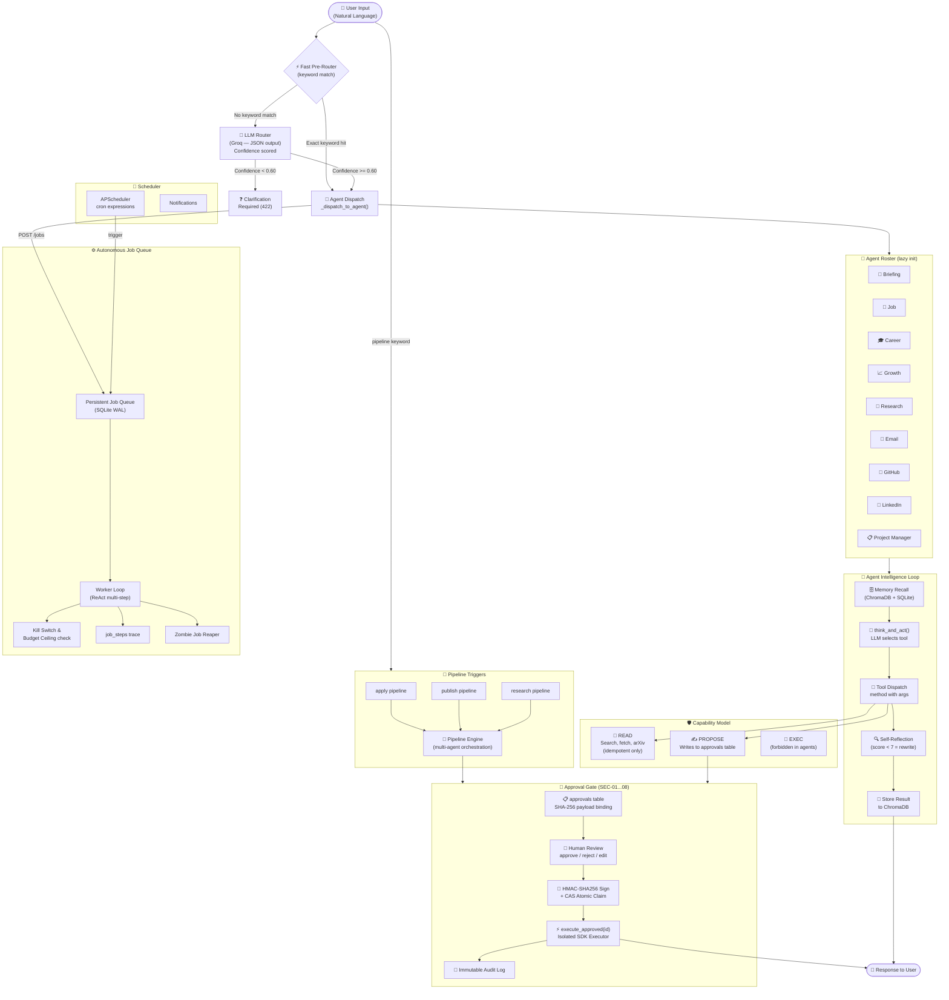

# 🤖 Orchestrator Agent — User Guide

> **Version**: `1.0.0` &nbsp;|&nbsp; **Author**: Farhan Aaqil &nbsp;|&nbsp; **Updated**: October 2026

---

## Table of Contents

1. [What is the Orchestrator Agent?](#1-what-is-the-orchestrator-agent)
2. [System Workflow — Flowchart](#2-system-workflow--flowchart)
3. [Agent Roster & What Each Agent Does](#3-agent-roster--what-each-agent-does)
4. [Operations You Can Perform](#4-operations-you-can-perform)
   - [4.1 Briefing & Status](#41-briefing--status)
   - [4.2 Job Hunting](#42-job-hunting)
   - [4.3 Career & Resume](#43-career--resume)
   - [4.4 Content & Growth](#44-content--growth)
   - [4.5 Research & Academic](#45-research--academic)
   - [4.6 GitHub](#46-github)
   - [4.7 Email](#47-email)
   - [4.8 Project Management](#48-project-management)
   - [4.9 Multi-Agent Pipelines](#49-multi-agent-pipelines)
   - [4.10 Approvals & Human-in-the-Loop](#410-approvals--human-in-the-loop)
   - [4.11 Scheduling & Automation](#411-scheduling--automation)
   - [4.12 Memory Management](#412-memory-management)
   - [4.13 System Controls](#413-system-controls)
5. [Step-by-Step Instructions](#5-step-by-step-instructions)
6. [Command Quick-Reference Card](#6-command-quick-reference-card)
7. [Security & Approval Gate](#7-security--approval-gate)
8. [Troubleshooting](#8-troubleshooting)

---

## 1. What is the Orchestrator Agent?

The **Orchestrator Agent** ("Aaqil AI") is an enterprise-grade, autonomous multi-agent system that acts as your personal AI Chief of Staff. You speak to it in **plain English** — it decides which specialized agent should handle your request, executes the task, and returns a result. Anything that affects the real world (sending an email, posting to LinkedIn, creating a GitHub issue) is **blocked behind a mandatory human approval gate**.

**Core capabilities at a glance:**
- 🧠 9 specialized agents (briefing, job, career, growth, research, email, GitHub, LinkedIn, project manager)
- 🔒 Cryptographic human-in-the-loop approval gate (no agent can act unilaterally)
- 📅 Autonomous background scheduler (cron-based recurring tasks)
- 🧬 Multi-tier memory (semantic vector store + SQLite episodic memory)
- 🌐 Sandboxed web browsing (Playwright with SSRF guard)
- 🔁 Three pre-built multi-agent pipelines (apply, publish, research)

---

## 2. System Workflow — Flowchart



### How a Request Flows (Summary)

| Step | What Happens |
|------|-------------|
| **1. Input** | You type a command in natural language via the Chat UI or REST API |
| **2. Fast Pre-Router** | Keyword table checked first (zero-latency routing for common phrases) |
| **3. Pipeline Check** | If "apply pipeline / publish pipeline / research pipeline" detected → multi-agent pipeline triggered |
| **4. LLM Router** | Groq LLM classifies intent, assigns agent, checks confidence ≥ 0.60 |
| **5. Agent Brain** | Selected agent recalls memory → `think_and_act()` → picks tool → executes → self-reflects |
| **6. Capability Gate** | READ tools execute immediately; PROPOSE tools write to approvals table |
| **7. Human Approval** | You review, then `approve <ID>` or `reject <ID>` |
| **8. Execution** | Cryptographically signed executor runs the approved action |
| **9. Memory** | Result stored in ChromaDB for future context |

---

## 3. Agent Roster & What Each Agent Does

| Agent | Trigger Keywords | Core Responsibilities |
|-------|-----------------|----------------------|
| **📰 Briefing** | `morning briefing`, `good morning`, `daily briefing`, `generate briefing` | Morning status, AI/ML news, GitHub activity, task priorities |
| **💼 Job** | `show jobs`, `find internship`, `search internshala`, `job dashboard` | Job search, cover letter generation, application tracking |
| **🎓 Career** | `show skills`, `my skills`, `career dashboard`, `career stats` | Resume tailoring, skill-gap analysis, interview prep, certifications |
| **📈 Growth** | `linkedin post`, `twitter thread`, `blog post`, `content calendar`, `content dashboard` | LinkedIn posts, Twitter threads, blog articles, devlogs, SEO tags |
| **🔬 Research** | `write paper`, `show papers`, `my papers`, `research dashboard` | Academic paper drafting, ArXiv search, journal recommendations, submission emails |
| **📧 Email** | `show emails`, `draft email` | Email triage (IMAP read), draft proposals, send (gated) |
| **🐙 GitHub** | `show github`, `github profile`, `generate readme`, `commit message` | Repo inspection, README generation, commit messages, issues (gated) |
| **🔗 LinkedIn** | `linkedin profile`, `linkedin lookup` | Public profile lookup, post drafting (gated) |
| **📋 Project Manager** | `show tasks`, `add task`, `show all projects`, `show goals` | Task management, project tracking, goal setting |
| **🧠 Orchestrator** | *(fallback)* | General conversation, system questions, routing fallback |

---

## 4. Operations You Can Perform

### 4.1 Briefing & Status

| Operation | Command Example |
|-----------|----------------|
| Full morning briefing | `morning briefing` / `good morning` |
| Quick status snapshot | `quick status` |
| Latest AI/ML news | `ai news` / `what's happening in AI` |
| Track news interest | `track news about LLM agents` |

### 4.2 Job Hunting

| Operation | Command Example |
|-----------|----------------|
| Browse job listings | `show jobs` / `job dashboard` |
| Find internships | `find internship` |
| Search Internshala | `search internshala for AI intern` |
| View all applications | `all jobs` |
| Generate cover letter | `generate cover letter for Google, ML Engineer` |

### 4.3 Career & Resume

| Operation | Command Example |
|-----------|----------------|
| Tailor resume to JD | `tailor resume for [paste JD here]` |
| Skill gap analysis | `skill gap for senior ML engineer at OpenAI` |
| Interview preparation | `interview prep for Google, Software Engineer` |
| Log interview outcome | `I got rejected from Amazon, feedback: need DSA` |
| Certificate suggestions | `what certs should I get` |
| View skills tracker | `show skills` / `my skills` |
| Career dashboard | `career dashboard` / `career stats` |
| Add a new skill | `add skill: Docker, level: intermediate` |
| Motivational career advice | `career advice` |

### 4.4 Content & Growth

| Operation | Command Example |
|-----------|----------------|
| LinkedIn post | `linkedin post for my Orchestrator Agent project` |
| Twitter/X thread | `twitter thread for diffusion models explainer` |
| Full blog post | `blog post for my orchestrator agent project` |
| Devlog entry | `devlog day 12, built: approval gate, challenges: HMAC signing` |
| Content calendar | `content calendar for 2 weeks` |
| A/B test LinkedIn post | `ab test linkedin post for [project]` |
| SEO tags | `seo tags for Building LLM Agents with FastAPI` |
| Content dashboard | `content dashboard` / `my content` |

### 4.5 Research & Academic

| Operation | Command Example |
|-----------|----------------|
| Write a full paper | `write paper: Autonomous Agent Safety, description: survey of approval gates` |
| Improve an existing paper | `improve paper 3, feedback: add ablation study` |
| Read & summarize arXiv PDF | `read paper https://arxiv.org/pdf/2403.xxxxx.pdf` |
| Find open-access journals | `find journals for AI safety` |
| Recommend target journals | `recommend journals for my paper on LLM agents` |
| Check if journal is predatory | `is IJCA predatory` |
| Draft submission email | `submission email for Agent Safety Survey, journal: IEEE Access` |
| Draft cover letter | `research cover letter for Agent Safety Survey, IEEE Access` |
| Update paper status | `update paper 3 to submitted` |
| Research dashboard | `research dashboard` / `show papers` |

### 4.6 GitHub

| Operation | Command Example |
|-----------|----------------|
| View GitHub profile | `show github` / `github profile` |
| Generate README | `generate readme for my orchestrator-agent repo` |
| Generate commit message | `commit message: fixed HMAC verification bug in approval gate` |
| List repositories | `list my repos` |
| Create issue *(gated)* | `create github issue: HMAC edge case on reject` → must approve |
| Add comment *(gated)* | `comment on issue #12: acknowledged` → must approve |

### 4.7 Email

| Operation | Command Example |
|-----------|----------------|
| Show inbox / emails | `show emails` |
| Draft email | `draft email to hireteam@company.com re internship application` |
| Send email *(gated)* | Drafts queue for approval → `approve <ID>` to send |

### 4.8 Project Management

| Operation | Command Example |
|-----------|----------------|
| List all tasks | `show tasks` / `show all tasks` |
| Add a task | `add task: implement rate limiting, priority: high, project: orchestrator` |
| Show all projects | `show all projects` |
| View goals | `show goals` |
| Update task status | `mark task 5 done` |

### 4.9 Multi-Agent Pipelines

These commands trigger coordinated multi-agent workflows. Each pipeline ends with an approval request before anything is sent externally.

#### Apply Pipeline
Runs **CareerAgent → JobAgent → CriticAgent → Approval**

```
apply pipeline <Company>, <Role>, <Job Description>, <Contact Email>

# Examples:
apply pipeline Google, ML Intern, [paste JD], hiring@google.com
apply pipeline to OpenAI, Research Engineer, We are looking for..., jobs@openai.com
```

**Pipeline steps:**
1. 🔍 Skill match check (score < 6/10 → pipeline paused with recommendation)
2. 📄 Resume tailored to the job description
3. ✉️ Cover letter generated and critic-reviewed
4. ✅ Full package queued for your approval

#### Publish Pipeline
Runs **GrowthAgent → CriticAgent → Approval**

```
publish pipeline <Project>, <Details>
content pipeline <Project>, <Details>

# Example:
publish pipeline Orchestrator Agent v1.0, Multi-agent system with approval gate
```

**Pipeline steps:**
1. 📝 LinkedIn post generated and critic-reviewed
2. 📰 Full blog post generated (saved to DB)
3. ✅ Queued for your approval before publishing

#### Research Pipeline
Runs **ResearchAgent → CriticAgent → Approval**

```
research pipeline <Topic>, <Description>, <Target Journal>

# Example:
research pipeline LLM Safety Agents, Survey of approval gates and HITL systems, IEEE Access
```

**Pipeline steps:**
1. 📜 Full paper drafted with real ArXiv citations
2. 🔍 Critic reviews and improves the draft
3. 🎯 DOAJ journal search + LLM venue recommendations
4. ✅ Summary queued for your approval

### 4.10 Approvals & Human-in-the-Loop

Any action that touches the external world (sending emails, GitHub mutations, publishing) is **blocked** until you explicitly approve it.

| Operation | Command |
|-----------|---------|
| View all pending approvals | `show approvals` / `pending approvals` |
| Approve an action | `approve 3` *(replace 3 with the approval ID)* |
| Reject an action | `reject 3` |
| Edit a proposal *(via API)* | `POST /approvals/3/edit` with new payload |
| Execute after approval *(via API)* | `POST /approvals/3/execute` |

> **Important:** Every approve/reject action is recorded in an **immutable audit log**. Approvals are cryptographically signed with HMAC-SHA256 and payload-hash-bound. If an approval's payload is changed between when you see it and when you click approve, the system rejects it (TOCTOU protection).

### 4.11 Scheduling & Automation

Set recurring tasks using cron expressions or preset cadences.

| Operation | API / UI Action |
|-----------|----------------|
| List all schedules | `GET /schedules` |
| Create a daily briefing | `POST /schedules` with `cron_expr: "0 9 * * *"`, `agent: "briefing"`, `task: "morning briefing"` |
| Enable / disable schedule | `PATCH /schedules/{id}` with `{"enabled": true/false}` |
| Run a schedule immediately | `POST /schedules/{id}/run-now` |
| Delete a schedule | `DELETE /schedules/{id}` |

**Preset cadences available in the UI:** 15 minutes, Hourly, Daily, Weekly

**Common cron expressions:**

```
0 9 * * *        → Every day at 9:00 AM
0 */4 * * *      → Every 4 hours
0 9 * * 1        → Every Monday at 9:00 AM
*/15 * * * *     → Every 15 minutes
```

### 4.12 Memory Management

The system stores two types of memory:
- **Semantic Facts** — preferences, facts, and learned context (SQLite + ChromaDB vectors)
- **Episodic Summaries** — auto-generated conversation summaries after 10 turns

| Operation | Command / API |
|-----------|--------------|
| Store a fact | `POST /memory` `{"kind": "fact", "key": "timezone", "value": "UTC+5:30"}` |
| Store a preference | `POST /memory` `{"kind": "preference", "key": "content_style", "value": "technical but witty"}` |
| Query memory | `GET /memory?query=timezone` |
| Review pending memory | `GET /memory?pending_review=true` |
| Confirm a memory item | `PATCH /memory/{id}` `{"pending_review": false}` |
| Update a memory item | `PATCH /memory/{id}` `{"value": "new value"}` |
| Delete a memory item | `DELETE /memory/{id}` |

### 4.13 System Controls

| Operation | UI / API |
|-----------|---------|
| Activate kill switch (emergency halt) | Settings → Toggle **Emergency Kill Switch** ON, or `POST /system/kill-switch {"on": true}` |
| Deactivate kill switch | `POST /system/kill-switch {"on": false}` |
| Check circuit breaker status | `GET /system/circuit` |
| Reset open circuit breaker | `POST /system/circuit/reset` |
| View system flags | `GET /system/flags` |
| Health check | `GET /health` |
| Run router benchmark | `POST /router-eval/run` |

---

## 5. Step-by-Step Instructions

### Starting the System

```bash
# Step 1 — Install dependencies
pip install -r requirements.txt

# Step 2 — Copy and configure environment variables
cp .env.example .env
# Edit .env: set GROQ_API_KEY, AUTH_TOKEN, EXECUTOR_HMAC_SECRET

# Step 3 — Start the API server & Web Control Plane
python -m uvicorn orchestrator_core.main:app --host 127.0.0.1 --port 8000

# Step 4 (optional) — Start the background autonomy worker
python -m orchestrator_core.jobs.worker

# Step 5 (optional) — Start the sandboxed browser container
docker build -t orchestrator-browser-sandbox docker/browser_sandbox
docker run -p 8888:8888 --read-only --tmpfs /tmp orchestrator-browser-sandbox
```

Access points after startup:
- **Web UI**: http://127.0.0.1:8000/
- **Swagger API Docs**: http://127.0.0.1:8000/docs

---

### Sending Your First Command

1. Open the **Web UI** → navigate to the **Chat** tab.
2. Type any natural language command (e.g., `morning briefing`).
3. The orchestrator displays which agent handled it (`routed_to: briefing`) and the full response.
4. If the agent produced a **PROPOSE action**, a notification will appear — check approvals next.

---

### Approving an Action

1. Ask: `show approvals`
2. Review the list — each item shows ID, type, content preview.
3. Type `approve 3` (replace `3` with the actual ID).
4. The action executes atomically; the audit log records the event.

---

### Running an Apply Pipeline

```
apply pipeline Google, ML Intern, [Full JD text here], hiring@google.com
```

1. The **CriticAgent** scores your skill match (must be ≥ 6/10 to proceed).
2. **CareerAgent** tailors your resume to the JD.
3. **JobAgent** generates a cover letter.
4. **CriticAgent** silently improves the cover letter.
5. Everything is bundled and sent to the **approvals queue**.
6. Type `show approvals` → review → `approve <ID>`.

---

### Running the Router Benchmark

```bash
# Validate classification accuracy against frozen 209-sample test set
python eval/run_eval.py --dry-run --split test --ci-gate --no-save
# Expected: 100.0% accuracy (106/106 correct)
```

---

### Creating a Backup

```bash
# Atomic snapshot (SQLite + ChromaDB + SHA-256 manifest)
python scripts/backup_restore.py snapshot --dest backups/snapshot_latest

# Verify backup integrity
python scripts/backup_restore.py verify --file backups/snapshot_latest/aaqil.db

# Restore (if needed)
python scripts/backup_restore.py restore-db --backup backups/snapshot_latest/aaqil.db --target aaqil.db
python scripts/backup_restore.py restore-chroma --archive backups/snapshot_latest/chroma.tar.gz --target chroma_db
```

---

### Emergency: Halting All Agents

If any agent behaves unexpectedly:

```bash
# Via API
curl -X POST http://127.0.0.1:8000/system/kill-switch \
     -H "Content-Type: application/json" \
     -d '{"on": true}'
```

Or in the **Web UI**: **Settings** → **Emergency Kill Switch** → toggle ON.

**Effect**: All running and queued agent loops abort within 1 step and transition to `cancelled`. Workers immediately stop claiming new jobs.

---

## 6. Command Quick-Reference Card

```
╔══════════════════════════════════════════════════════════════════════╗
║              ORCHESTRATOR AGENT — QUICK REFERENCE                    ║
╠═══════════════════════╦══════════════════════════════════════════════╣
║  BRIEFING             ║ morning briefing | quick status | ai news    ║
╠═══════════════════════╬══════════════════════════════════════════════╣
║  JOBS                 ║ show jobs | find internship | job dashboard   ║
╠═══════════════════════╬══════════════════════════════════════════════╣
║  CAREER               ║ tailor resume for [JD]                        ║
║                       ║ skill gap for [role]                          ║
║                       ║ interview prep for [company, role]            ║
║                       ║ show skills | career dashboard                ║
╠═══════════════════════╬══════════════════════════════════════════════╣
║  CONTENT              ║ linkedin post for [project]                   ║
║                       ║ twitter thread for [project]                  ║
║                       ║ blog post for [project]                       ║
║                       ║ content calendar                              ║
╠═══════════════════════╬══════════════════════════════════════════════╣
║  RESEARCH             ║ write paper: [topic], [description]           ║
║                       ║ find journals for [topic]                     ║
║                       ║ show papers | research dashboard              ║
╠═══════════════════════╬══════════════════════════════════════════════╣
║  GITHUB               ║ show github | generate readme for [repo]      ║
║                       ║ commit message: [description]                 ║
╠═══════════════════════╬══════════════════════════════════════════════╣
║  EMAIL                ║ show emails | draft email to [email] re [sub] ║
╠═══════════════════════╬══════════════════════════════════════════════╣
║  TASKS                ║ show tasks | add task: [title]               ║
║                       ║ show all projects | show goals                ║
╠═══════════════════════╬══════════════════════════════════════════════╣
║  PIPELINES            ║ apply pipeline [company, role, JD, email]    ║
║                       ║ publish pipeline [project, details]           ║
║                       ║ research pipeline [topic, desc, journal]      ║
╠═══════════════════════╬══════════════════════════════════════════════╣
║  APPROVALS            ║ show approvals | approve [ID] | reject [ID]  ║
╠═══════════════════════╬══════════════════════════════════════════════╣
║  SYSTEM               ║ kill switch ON / OFF (via UI or API)         ║
╚═══════════════════════╩══════════════════════════════════════════════╝
```

---

## 7. Security & Approval Gate

The approval gate enforces **8 security policies** (SEC-01 through SEC-08):

| Policy | What It Prevents |
|--------|-----------------|
| **SEC-01** Zero-Parameter Contract | Callers cannot substitute payloads at execution time |
| **SEC-02** SHA-256 Payload Binding | Any tampering with action/target/payload invalidates the hash |
| **SEC-03** HMAC-SHA256 Signing | Server signs every approval; execution verifies signature |
| **SEC-04** CAS Concurrency | Atomic compare-and-set prevents double execution and replay attacks |
| **SEC-05** State Machine | Pending/rejected/expired approvals refuse execution immediately |
| **SEC-06** Edit-and-Supersede | Editing creates a new pending approval; old one is `superseded` |
| **SEC-07** Immutable Audit Log | Every decision is permanently recorded — cannot be erased |
| **SEC-08** Target Recipient Policy | Blocklist filtering + unverified destination flagging |
| **TOCTOU** Hash Verification | `expected_hash` on approve endpoint prevents race-condition payload swaps |

> **Caution:** Never share your `EXECUTOR_HMAC_SECRET` or `AUTH_TOKEN`. These are the cryptographic roots of trust. Rotate them immediately if compromised.

---

## 8. Troubleshooting

### Router returns 422 (needs clarification)
Your command's confidence score fell below the **0.60 threshold**. Try being more specific:
- ❌ `do something with my work` → too vague
- ✅ `show tasks` or `career dashboard`

### Agent times out
Each agent has a 90-second LLM timeout. For long tasks, use the **autonomous job queue** instead:
```bash
POST /jobs  {"agent": "research_agent", "goal": "Write paper on diffusion models", "max_steps": 25}
```

### Circuit breaker is OPEN
The router failed 3 or more times in 30 seconds. Reset it:
```bash
curl -X POST http://127.0.0.1:8000/system/circuit/reset
```

### Approval ID not found
The approval may have been previously resolved. Check all pending approvals:
```bash
GET /approvals?status=pending
```

### Pipeline paused: skill match too low
The **Apply Pipeline** scored your match below 6/10. The agent will suggest which skills to acquire first. Use `skill gap for [role]` for a deeper analysis.

### Memory growing large / context drift
Session memory auto-summarizes after 10 turns and keeps only the last 4 turns for continuity. To manually clear an item:
```bash
DELETE /memory/{id}
```

### Kill switch accidentally left ON
```bash
curl -X POST http://127.0.0.1:8000/system/kill-switch \
     -H "Content-Type: application/json" \
     -d '{"on": false}'
```

---

## Related Documentation

| Document | Purpose |
|----------|---------|
| [Operations Runbook](runbook.md) | Production deployment, scaling, emergency controls |
| [Backup & Restore Runbook](backup_restore_runbook.md) | RPO/RTO verification, atomic snapshots |
| [Security Audit](security_audit.md) | Threat model and checklist |
| [ADR 0001 — Approval Gate](adr/0001-fastapi-core-and-approval-gate.md) | Architecture decision record |
| [ADR 0002 — Job Queue](adr/0002-job-state-machine-and-cas-claim.md) | Autonomous job queue design |
| [ADR 0003 — Tool Capability Model](adr/0003-tool-capability-model-and-ssrf-isolation.md) | SSRF isolation and capability model |
| [ADR 0004 — Browser Sandbox](adr/0004-sandbox-browser-playwright-security.md) | Playwright sandbox and injection defense |
| [CHANGELOG](../CHANGELOG.md) | Version history |

---

*Made with 🤖 by Farhan Aaqil — [github.com/FarhanAaqil](https://github.com/FarhanAaqil)*
