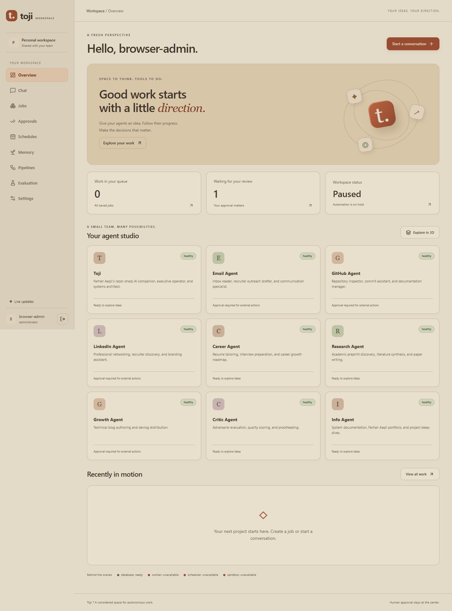

# Phase 3 workspace handoff

Verified locally on 2026-11-11. The supported browser application is the compiled
React/TypeScript workspace. Open http://127.0.0.1:8080 and sign in as admin using
the private password you created. The existing account and PostgreSQL data were
preserved. Automation is still paused; administrators can resume it in Settings
when they intend to run queued work.

## Interface and workflows

The user's chosen palette is warm and moderately light: oat, sand, clay, olive
and brown, with no white, navy, cyan or dark-mode surfaces. The workspace includes
overview, saved chat, jobs, exact approval review, schedules, reviewed memory,
pipelines, evaluation history, service diagnostics, budget and account controls.

Session cookies stay HttpOnly. The client keeps CSRF tokens only in memory and
sends them in request headers. Session revocation returns to login, including
live-event revocation. Role restrictions hide unavailable mutations, while the
API enforces authorization. Accounts share one workspace.

Chat keeps conversation IDs, shows saved history, loads older pages and exposes
interrupted-response errors. Provider responses remain buffered as documented
in Phase 2; SSE does not imply incremental model token delivery. Approval review
binds the exact snapshot hash, shows destination/mode/expiry, requires an explicit
review checkbox, and reports actual execution state and evidence. Queued pipeline
responses are followed through their job IDs, then their final run IDs.

Routine transitions use Motion. Reduced-motion users get stable route rendering
and the complete 2D agent list. The optional React Three Fiber constellation
loads only after an explicit request, renders on demand at capped pixel density,
unmounts when hidden, and has a fallback for unavailable WebGL. It currently
visualizes agent availability; it does not claim to depict actual inter-agent
message traffic. All agent facts remain in the accessible list.

## Verified evidence

- Typecheck, lint and production frontend build passed.
- Six transport unit checks passed: cookies/CSRF, endpoint errors, readiness
  failures, event parsing, transport chunk boundaries and interrupted responses.
- Seven real Chrome browser checks passed against a separate disposable API and
  worker: login/logout, role restrictions, exact approval/hash/simulation outcome,
  saved chat, memory review, schedules, queued pipeline/job state and cancellation,
  long history, session revocation, keyboard focus, mobile/reduced motion,
  optional 3D loading and WebGL absence. The two motion/fallback checks were
  rerun after the final reduced-motion change and passed.
- Eleven focused backend checks passed (four Phase 3 boundary checks and seven
  existing security checks). Ruff and diff checks passed.
- Three desktop endpoint/security checks passed. The unpacked Windows application
  loaded the login screen with sandbox=true, contextIsolation=true and
  nodeIntegration=false, then exited with code 0. The smoke window was hidden.
- The final Docker image built with npm ci from the committed lockfile. The API
  serves only frontend/dist and its assets; source/manifests and node_modules
  are not publicly mounted. Runtime inspection found no .env, tests, archived
  UIs or frontend node_modules.
- Deployed /health and /ready returned 200; database, worker, scheduler and
  sandbox were all ready. Anonymous /auth/session returned 401 and the obsolete
  /static/package.json returned 404. The compiled entry point has no runtime CDN.
- Compressed artifact checks passed: about 127.5 kB initial JavaScript and
  239.4 kB optional 3D, against 180/300 kB budgets. These are gzip measurements,
  not measured page latency or frame-time guarantees.
- CI now checks generated API contract drift, frontend build/lint/unit tests,
  artifact budgets, focused backend/desktop checks and the real browser flows.
  Remote CI has not been run for these unpushed local commits.

The complete 302-test suite was not run. Full accessibility/screen-reader review,
representative hardware performance and memory measurements, comprehensive
adversarial/restart coverage, dependency advisory review, release signing and
the independent production-readiness assessment remain Phase 4 gates.

## Running and building

From the repository root:

```powershell
docker compose up -d
```

For a new build:

```powershell
docker compose build orchestrator_core
docker compose up -d
```

The verified unsigned Windows folder is toji-shell/dist/win-unpacked. Open Toji.exe
inside that folder; keep its supporting files beside it. It connects to the same
8080 backend and never starts a duplicate server. See [desktop instructions](../toji-shell/README.md)
for changing TOJI_API_URL or producing an installer. The former machine-specific
overlay, voice and auto-sidecar code is archived and excluded from packaging.

For frontend development, run npm ci --ignore-scripts --no-audit --no-fund,
then npm run dev in frontend. The Vite proxy uses the same 8080 API. On this
machine Google Drive caused npm extraction errors, so validation used a local
temporary build directory with the committed manifests and sources. Docker
builds provide a reproducible alternative without host node_modules.

To regenerate contract types:

```powershell
python scripts/export_frontend_contract.py
cd frontend
npm run contract
```

To run the isolated browser fixtures, build frontend/dist first, start
python scripts/phase3_browser_server.py in one terminal, and run npm run
test:browser in frontend in another. Fixture users/passwords are public test data
and exist only in a temporary database; this server must never be exposed beyond
loopback. Tests do not use the user's admin password or personal provider keys.


